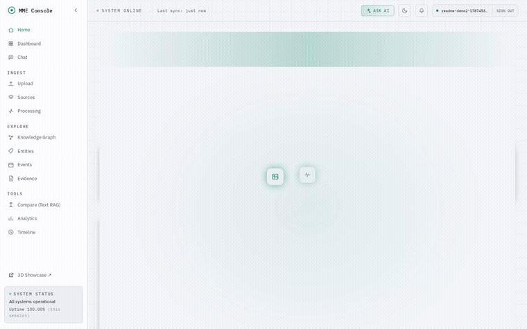
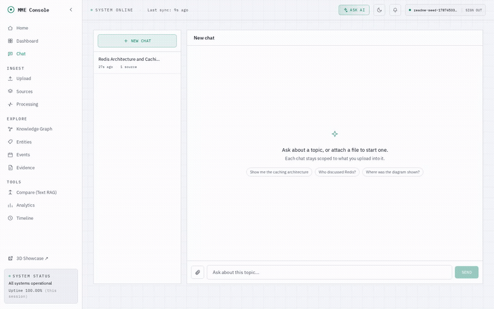
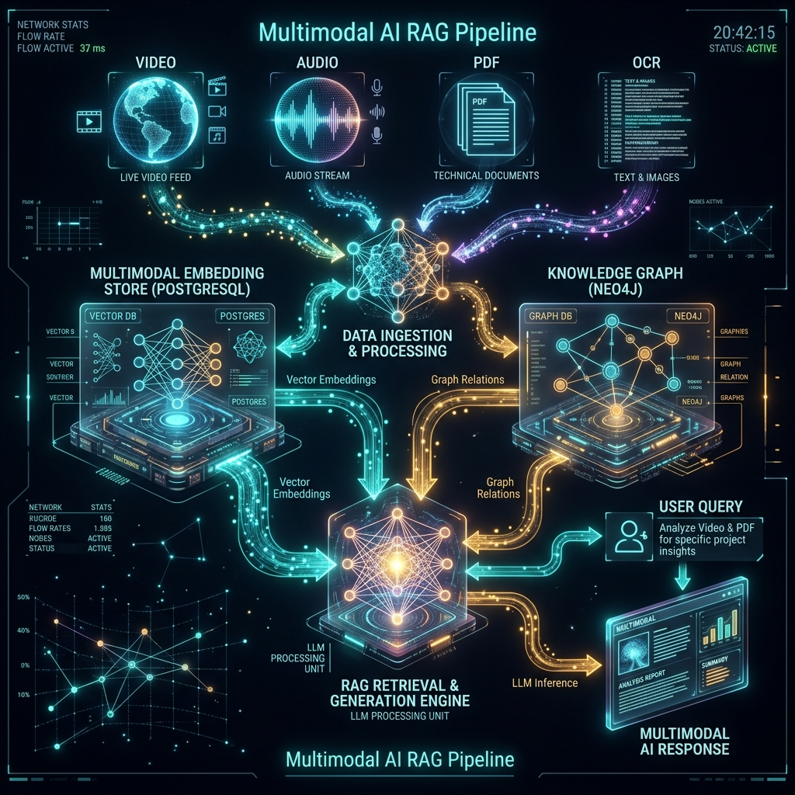
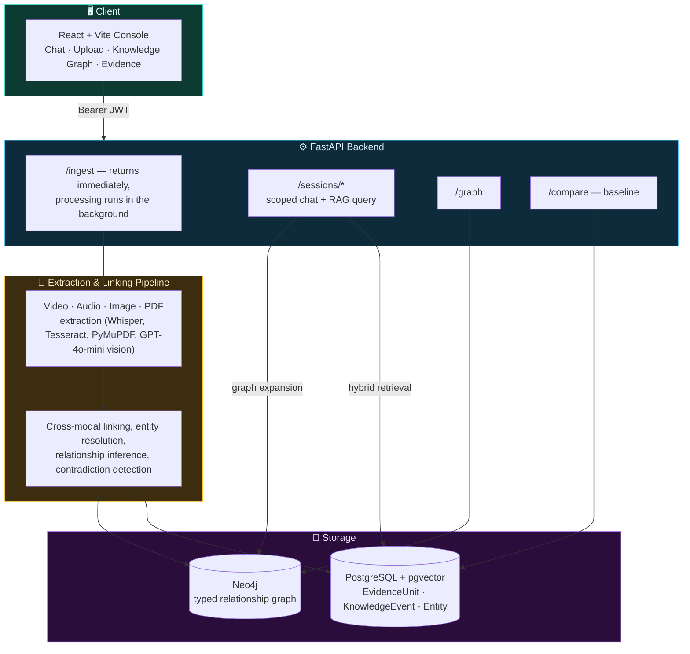
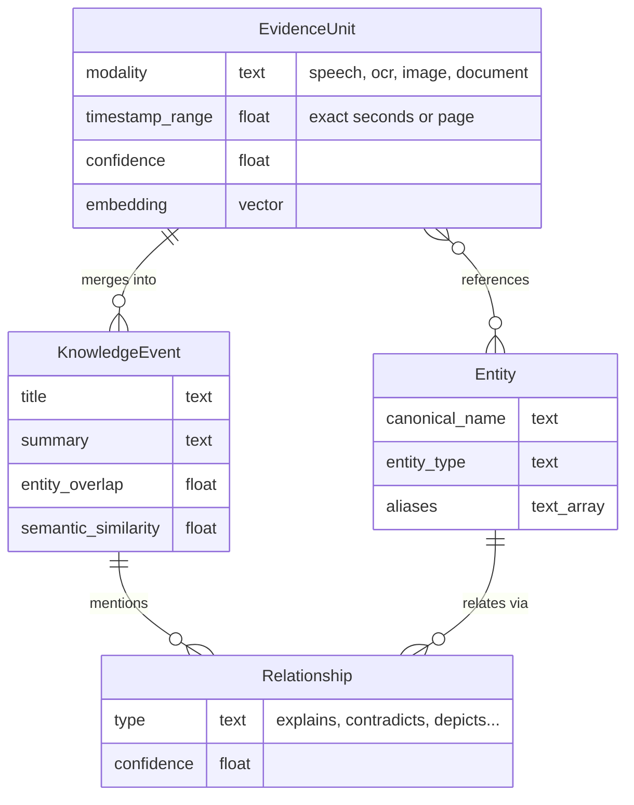
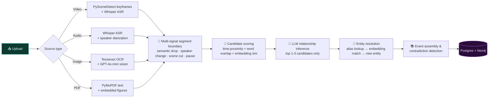

<div align="center">

# 🌌 Multimodal Evidence Console

### A Multimodal Data Management Pipeline for RAG-Ready Systems

[](https://fastapi.tiangolo.com/)
[](https://react.dev/)
[](https://www.typescriptlang.org/)
[](https://www.postgresql.org/)
[](https://neo4j.com/)
[](https://www.docker.com/)
[](https://openai.com/)
[](#)

**Author & Maker:** Yug

**Video, audio, images, and PDFs go in. A provenance-grounded knowledge graph you can chat with comes out —**
**every answer traceable to the exact second of video or page of a document it came from.**

<br/>



<sub>Real capture of the actual running app opening — not a mockup.</sub>

</div>

<br/>

---

## 📖 Table of Contents

- [Why this exists](#-why-this-exists)
- [See it work](#-see-it-work)
- [What's inside](#-whats-inside)
- [System architecture](#-system-architecture)
- [The four core entities](#-the-four-core-entities)
- [Cross-modal & temporal linking pipeline](#-cross-modal--temporal-linking-pipeline)
- [Retrieval & comparison logic](#-retrieval--comparison-logic)
- [Quickstart](#-quickstart)
- [Tech stack](#-tech-stack)
- [Evaluation](#-system-evaluation-multimodal-graph-vs-flat-text-baseline)
- [Future improvements](#-future-improvements)
- [Alternate embedded implementation](#-alternate-implementation-embedded-stack)

---

## 🎯 Why this exists

Conventional RAG pipelines treat everything as text: a video becomes a transcript, a PDF becomes chunks, an
image becomes a caption — and the moment it's flattened, the *connections* between what was said, what was on
screen, and what the document says are gone forever. Ask "what architecture reduces database load, and who
explained it?" and a flat-chunk system can retrieve the sentence, but never the diagram it was pointing at.

This project keeps every modality as a first-class, timestamped, page-numbered observation — and **links them
to each other**, not just to a vector index.

---

## 🎬 See it work

Every screenshot and clip below is a real capture of the app actually running against a live OpenAI-backed
pipeline — nothing here is a mockup or a hardcoded demo state.

<div align="center">

<br/>
<sub>Every answer is grounded in real evidence — click a citation and it opens the <em>exact</em> video timestamp or PDF page it came from, right in the chat.</sub>
</div>

---

## 📦 What's inside

| | |
|---|---|
| 💬 **Per-topic RAG chat** | Each chat is scoped to only what you upload into it — a Redis video and an unrelated PDF never answer each other's questions. Session titles are generated live from the conversation, never hardcoded. |
| 📎 **Multi-file ingest** | Attach as many files as you want to one topic — video, then a PDF, then another video — each tracked with its own live processing status. |
| 🔍 **Click-through evidence** | Every citation is clickable. It opens a real video player seeked to the exact second, or a PDF opened on its exact page, with the extracted text alongside it. |
| 🕸️ **Interactive knowledge graph** | A live, force-directed graph of every Entity, EvidenceUnit, and KnowledgeEvent your corpus has produced — not a static diagram. |
| ⚖️ **Text-only baseline comparison** | Run the same query against a naive flat-chunk RAG baseline side-by-side, to see what cross-modal linking actually buys you. |
| 🚫 **No hallucinated answers** | If nothing in your uploaded evidence actually supports an answer, the system says so — it never falls back to the model's general knowledge. |
| ⚡ **Fast, resilient ingestion** | Audio is chunked and transcribed in parallel, every OpenAI call retries through rate limits with backoff, and long videos (1hr+) no longer silently fail partway through. |

---

## 🏛️ System Architecture

<div align="center">

</div>



Conventional RAG pipelines slice documents into arbitrary, fixed-size chunks, losing all inter-modal context
and temporal structure. This system represents knowledge using **four first-class database entities** to
preserve cross-modal meaning instead.

---

## 🧬 The 4 Core Entities



| Entity | Description | Fields & Provenance |
| :--- | :--- | :--- |
| **EvidenceUnit** | A raw, single-modality observation extracted from source media. | Content text, source ID, modality (speech, video, PDF, OCR), exact timestamp/page/bbox, confidence score, and high-dimensional vector embedding. |
| **KnowledgeEvent** | Reconstructed meaning spanning one or more EvidenceUnits. | Title, summary, timestamp range, entity associations, and multi-evidence confidence score. |
| **Entity** | A globally canonicalized noun, resolved across all files and modalities. | Canonical name, entity type, description, aliases, and embedding representation. |
| **Relationship** | A first-class typed connection between two entities or events. | Source, target, type (`explains`, `supports`, `corresponds_to`, `contradicts`, `depicts`), and auditable components (`temporal_overlap`, `entity_overlap`, `semantic_similarity`). |

---

## 🔗 Cross-Modal & Temporal Linking Pipeline



### 1. Multi-Signal Semantic Segmentation
Instead of cutting transcripts at fixed durations, boundaries are generated where a computed boundary score peaks:
$$\text{Boundary Strength} = f(\text{Semantic Similarity Drop}, \text{Speaker Change}, \text{Scene Cut}, \text{Acoustic Pause})$$

### 2. Candidate Pruning (Cost Control)
Ingesting hours of video using all-pairs LLM comparison is prohibitively expensive. This system runs a pre-LLM scoring pass using timestamp proximity, word overlap, and embedding similarity:
$$\text{Score} = w_1 \cdot \text{TimeProximity} + w_2 \cdot \text{WordOverlap} + w_3 \cdot \text{EmbeddingSim}$$
Only the top **1–3 candidates** per window are sent to the LLM for structured relationship classification. Every OpenAI call in the pipeline runs through a shared, bounded-concurrency backoff wrapper — independent stages (audio extraction ∥ frame sampling, transcription ∥ diarization) run in parallel, but rate limits are retried instead of failing the whole job.

### 3. Entity Resolution
Entity extraction normalizes names using a safe-fallback cascade:
1. **Alias Dictionary Lookup**: Map "PG", "Postgres", and "PostgreSQL" to the same ID.
2. **Embedding Similarity Match**: Compare vector similarity against existing entities; merge if above a strict threshold.
3. **New Entity Creation**: Fallback option.

### 4. Contradiction & Supersession Detection
Chronological evidence on the same entity is evaluated pairwise. If a newer claim contradicts an older one (e.g., "use Redis caching" followed later by "do not use Redis, use Memcached"), a `contradicts` edge is registered in Neo4j. Retrieval queries use this to surface the latest decision while keeping the old one visible but flagged.

---

## 🔍 Retrieval & Comparison Logic

### Hybrid Three-Path Retrieval
When a user asks a question inside a chat topic, the system executes three parallel search paths — **scoped to only that topic's sources**, so a query in one chat can never surface evidence from another:
1. **Vector Match**: Cosine similarity against `EvidenceUnit.embedding`.
2. **Event Match**: Cosine similarity against consolidated `KnowledgeEvent` embeddings.
3. **Entity Match**: Extracts query entities, searches Neo4j for matching nodes, and fetches all connected evidence units.

### Resolution & Synthesis
The engine expands the retrieved set by executing a 1–2 hop traversal in Neo4j. Contradicting relationships are filtered by chronological order. A multimodal LLM synthesizes the final answer using text-based logs, OCR bounding boxes, and video frames, citing the exact source IDs in the database — and if nothing in scope actually supports an answer, it says so instead of reaching for general knowledge.

### 📊 System Evaluation: Multimodal Graph vs. Flat-Text Baseline

To prove the pipeline's value, we run a text-only RAG baseline in `backend/app/baseline/` that splits documents into flat, unstructured 500-token chunks. The `eval/run_eval.py` script compares performance against a labeled query set:

| Dimension | Conventional Text-Only RAG | Our Multimodal Graph RAG |
| :--- | :--- | :--- |
| **Cross-Modal Retrieval** | Fails; cannot connect a spoken comment at 01:24 with a diagram shown on screen. | **Succeeds**; traverses temporal and semantic edges between keyframes, OCR, and ASR. |
| **Provenance Tracking** | Returns a generic chunk with no location data. | **Succeeds**; highlights exact video timestamps, PDF pages, and OCR bounding boxes — click any citation to see it. |
| **Resolution of Conflict** | Retrieves both contradictory statements as equally relevant. | **Succeeds**; detects chronological contradictions, prioritizing the most recent decision. |

To run the evaluation suite:
```bash
cd eval
python run_eval.py http://localhost:8000
```

---

## 🚀 Quickstart

1. **Configure Environment Variables** — copy `.env.example` to `.env` and fill in your keys:
   ```env
   OPENAI_API_KEY=your_openai_api_key_here
   # Optional: set HF_TOKEN for pyannote.audio speaker diarization (free at huggingface.co)
   HF_TOKEN=your_huggingface_token
   ```
   > [!NOTE]
   > If `HF_TOKEN` is omitted, speaker diarization is skipped, and segmentation falls back to semantic-similarity + scene-change + pause signals.
   >
   > Firebase Authentication needs its own keys — see the Firebase section of `.env.example` and put the `VITE_FIREBASE_*` client keys in `frontend/.env`. Leaving `VITE_FIREBASE_API_KEY` unset runs the frontend in mock-auth mode, no Firebase project required.

2. **Launch services**:
   ```bash
   docker compose up -d --build
   ```

3. **Run database migrations**:
   ```bash
   docker compose exec backend alembic upgrade head
   ```

4. **Open the console**:
   - **Frontend**: [http://localhost:5173](http://localhost:5173)
   - **Backend API docs**: [http://localhost:8000/docs](http://localhost:8000/docs)
   - **Health check**: [http://localhost:8000/health](http://localhost:8000/health) → `{"status":"ok"}`

5. **Try it end to end**:
   - Go to **Upload** (or the **Chat** page's attach button), pick a video/audio/PDF/image — the type is auto-detected from the extension — and click **Ingest & Start Chat**.
   - You land directly in a chat scoped to that file. Ask it a question once ingestion finishes; click any citation in the answer to see the exact moment or page it came from.
   - The **Knowledge Graph** page visualizes everything ingested so far as a live, interactive graph. **Compare (Text RAG)** runs the same query against the naive baseline side-by-side.

---

## 🛠️ Tech Stack

| Layer | Technology | Why |
|---|---|---|
| **Backend** | FastAPI, Python 3.11, async SQLAlchemy 2.x | Fully async request path — ingestion never blocks the API. |
| **Storage** | PostgreSQL 16 + pgvector, Neo4j 5 | One store for structured/vector data, one for typed relationship traversal. |
| **Extraction** | OpenAI Whisper, GPT-4o / GPT-4o-mini (vision + text), Tesseract, PyMuPDF, PySceneDetect, pyannote.audio | ASR, OCR, vision captioning, PDF parsing, scene detection, speaker diarization. |
| **Frontend** | React 18, TypeScript, Vite, Tailwind CSS | CSS-variable-driven theming, a real force-directed graph canvas, no fabricated UI state. |
| **Auth** | Firebase Authentication (JWT) | Real per-user session ownership, not a shared anonymous corpus. |
| **Orchestration** | Docker Compose | One command to stand up Postgres, Neo4j, backend, and frontend together. |
| **Testing** | pytest (backend), Vitest + React Testing Library (frontend) | 90+ backend tests, 35+ frontend tests, all exercising real behavior — no fabricated assertions. |

---

## 🛠️ Future Improvements

- **Interactive Bounding Box Highlighting**: True PDF.js integration in the browser to highlight bounding boxes in-page instead of jumping to the page number.
- **Visual Entity Resolution**: Merge visual entities (e.g., matching a face in a frame or a logo on a slide) with text-extracted entities using multi-modal embedding models.
- **Real-Time Streaming Status**: Replace polling with WebSockets or Server-Sent Events (SSE) to stream extraction logs from ffmpeg, Whisper, and Tesseract.
- **LLM Reranking**: Incorporate a cross-encoder model to rerank fusion results prior to answer synthesis.
- **Real job queue**: A dedicated worker pool (Celery/RQ) instead of FastAPI `BackgroundTasks`, for horizontal scale-out of ingestion.

---

<details>
<summary><b>📦 Alternate implementation (embedded stack) — click to expand</b></summary>

This repository also contains a **second, independent, complete implementation** of the same brief, built in
parallel exploration. It shares no source files with the implementation documented above — only this README,
`.env.example`, and `.gitignore`.

| | **A — Server stack** (documented above) | **B — Embedded stack** |
|---|---|---|
| Code | `backend/`, `frontend/` | `src/`, `api/`, `frontend-standalone/` |
| Canonical store | Postgres + pgvector | SQLite |
| Vector index | pgvector | Chroma (text / image / event collections) |
| Graph | Neo4j | Kuzu (embedded) |
| LLM / ASR | OpenAI (Whisper, GPT-4o / GPT-4o-mini) | Gemini, with local Ollama fallback |
| Image embeddings | text-embedding via captions | CLIP, as a first-class second space |
| Auth | Firebase Authentication (JWT) | none |
| UI | React + Vite + Tailwind dashboard | Single-file HTML, served at `/ui` |
| Runtime | Docker Compose | `venv` only, no Docker, no servers |
| Eval | `eval/run_eval.py` | `python -m src.eval.evaluate` |

### What this is

- **Real dataset, not synthetic**, with a citable source: an MIT 6.824 Distributed Systems lecture on
  Facebook's Memcache caching architecture, paired with the actual research paper it's based on.
- **Structured representation**: every extracted observation — a transcript sentence, a video keyframe, an
  OCR'd text region, a PDF paragraph, a paper's figure — becomes one canonical `EvidenceUnit` (content,
  modality, timestamp/page/bbox, source, entities, relationships, confidence, provenance), not a bespoke
  per-modality record.
- **Cross-modal + temporal linking**: three independent mechanisms connect units to each other — same-source
  temporal co-occurrence, Chroma-ANN semantic similarity (text *and* CLIP embedding spaces, which is what
  catches a match with no shared timestamp at all, e.g. across two files), and shared-entity co-reference.
  Tightly-linked clusters are further materialized into persisted `KnowledgeEvent` bundles.
- **Hybrid retrieval**: a query is embedded into both spaces, searched against evidence/image/event indexes,
  expanded via graph traversal from the query's own resolved entities, fused with confidence into one ranking,
  and answered with a citation-grounded synthesis built from the actual retrieved evidence.
- **A required text-only baseline** (naive fixed-character chunking + plain vector search, same underlying
  embedding model) so the improvement from cross-modal linking is measurable, not asserted.
- **No hardcoding**: the ingestion/linking/retrieval code has no source-specific branches — point it at any
  video/audio/image/PDF via `configs`/CLI args and it produces the same structured output. The one legitimate
  exception is `src/eval/queries.py`, a hand-labeled *test fixture* for measuring retrieval quality, not
  pipeline logic.

### Architecture

```
Ingestion (per modality)          Normalize          Enrich & link                 Store                    Retrieve
─────────────────────────         ─────────          ─────────────                 ─────                    ────────
video  → ffmpeg audio +  ┐                                                    ┌─ SQLite (ledger:            
         scene keyframes │                                                   │  EvidenceUnit, source
audio  → faster-whisper  ┼──→  EvidenceUnit  ──→  entity/relationship  ──────┤  registry, KnowledgeEvent)   query
image  → OCR + caption   │     (one schema         extraction (batched        │                              ├─ embed (text + CLIP)
pdf    → PyMuPDF text +  ┘     for every            LLM calls) + graph-       ├─ Chroma (text/image/event    ├─ vector search
         figures               modality)            backed entity            │  embeddings, ANN search)     ├─ graph expansion
                                                     resolution                │                              ├─ confidence fusion
                                                            │                  └─ Kuzu (entities,             └─ grounded answer
                                                            ▼                     evidence, KnowledgeEvents,       (citations built
                                                cross-modal linking:              MENTIONS/RELATION/                from real evidence)
                                                temporal co-occurrence +          CO_OCCURS_WITH/
                                                Chroma-ANN semantic sim +         SEMANTICALLY_SIMILAR_TO/
                                                shared-entity co-reference        SAME_ENTITY_AS/CONTAINS)
                                                            │
                                                            ▼
                                                  event assembly: connected
                                                  components → persisted,
                                                  embedded KnowledgeEvents
```

### Storage

| Layer | Tech | Why |
|---|---|---|
| Canonical ledger | **SQLite** | Zero setup, ground truth for every `EvidenceUnit`/`Source`/`KnowledgeEvent`, trivially inspectable/exportable. |
| Vector index | **Chroma** (embedded, persistent) | Two embedding spaces kept genuinely separate — `text_embeddings` (sentence-transformers) and `image_embeddings` (CLIP) — because they are not directly comparable; a query is embedded into *both* rather than mixed into one index. A third `event_embeddings` collection indexes assembled multimodal moments. |
| Knowledge graph | **Kuzu** (embedded, no server/Docker) | Real Cypher queries, temporal-relationship edges, a demoable subgraph — chosen specifically because the build machine has neither Docker nor much free disk. |
| LLM | **Google Gemini**, behind a provider-agnostic interface with a local **Ollama** fallback | Vision captioning, open-vocabulary entity/relationship extraction, cross-modal link classification, event summarization, grounded answer synthesis. Swapping providers is a one-line config change (`LLM_PROVIDER`). |

### Why this isn't "convert to text and vector-search"

1. Images and frames get a **CLIP embedding independent of any OCR/caption text** — a query can match a
   diagram by *visual* similarity even if the text embedding wouldn't have surfaced it.
2. The **knowledge graph** stores relationships as first-class edges (`MENTIONS`, `RELATION`,
   `CO_OCCURS_WITH`, `SEMANTICALLY_SIMILAR_TO`, `SAME_ENTITY_AS`, `CONTAINS`) with confidence and, where
   meaningful, a timestamp — retrieval expands from a query's entities through this graph, recovering
   evidence that pure similarity search would miss.
3. **Provenance is exact**: every unit carries its source file, and either a timestamp range, a PDF page +
   bounding box, or an OCR bounding box — traceable back to the literal pixels/seconds it came from.
4. A **measured comparison against a real text-only baseline** rather than an assertion that the system is
   better.

### Dataset

Real, verified, openly-licensed — chosen so the *same* architecture is discussed in both spoken/visual form
and written form:

- **Lecture** (video, real speaker, real whiteboard/slide diagrams): [MIT 6.824 — Lecture 16, Cache Consistency: Memcached at Facebook](https://www.youtube.com/watch?v=Myp8z0ybdzM) (Spring 2020). An 18-minute opening excerpt is used for the demo, from the course's YouTube channel.
- **Paper** (same architecture, written form): [Scaling Memcache at Facebook](https://www.usenix.org/system/files/conference/nsdi13/nsdi13-final170_update.pdf), Nishtala et al., NSDI'13 (USENIX, open access).
- **Course site**: [pdos.csail.mit.edu/6.824](https://pdos.csail.mit.edu/6.824/) (CC BY 3.0 US).

The course's own lecture notes describe the memcache layer as producing a "100x reduction in DB read load" —
i.e. this pair was chosen because it is close to a verbatim match for the brief's own example question, not
despite it.

A small synthetic dataset (`test_data/*.mp4`, `*.pdf`, `*.png`, `*.wav`) is also included as a fast,
deterministic smoke-test fixture with known ground truth (`test_data/tech_talk.ground_truth.json`) — useful
for quickly checking the pipeline still works end-to-end, but the real dataset above is what the demo and
evaluation are built around.

### Quickstart

```bash
python3 -m venv .venv && source .venv/bin/activate
pip install -r requirements.txt
cp .env.example .env   # fill in GOOGLE_API_KEY, or leave LLM_PROVIDER=ollama for fully local

# Ingest the real dataset, then link + assemble events
python -m src.pipeline ingest data/real/memcache_facebook_paper.pdf data/real/lecture16_memcache_clip.mp4 --link
python -m src.pipeline stats

# Serve the API + UI
uvicorn api.main:app --reload --port 8000
# open http://localhost:8000/ui

# Evaluate against the text-only baseline
python -m src.eval.evaluate
```

### Key design decisions

- **Gemini free-tier quota forced a design change mid-build**: the available key is rate-limited (5
  requests/minute on the model actually usable). Calling an LLM once per tiny evidence unit (hundreds of
  transcript sentences/OCR regions) was not viable, so entity/relationship extraction is **batched** — up to
  35 units' text per call — with proactive request pacing and retry/backoff that parses the server's
  suggested delay. This is documented here rather than hidden because it's a real engineering tradeoff:
  batching trades a small amount of per-item extraction precision (the model sees several items at once) for
  the difference between a corpus finishing in minutes vs. not finishing at all.
- **CLIP embeddings from the start, not as an add-on**: images/frames are embedded in a joint text-image
  space so retrieval can find them by visual content, independent of whatever OCR or caption text happened to
  be extracted — directly answering the brief's warning against systems that just convert multimedia to text.
- **Kuzu over Neo4j, SQLite over Postgres, no Docker anywhere**: the build machine has no Docker installed and
  limited free disk; every storage choice is an embedded, zero-server library for exactly that reason.
- **KnowledgeEvents are assembled from connected components of *temporal/semantic* links only** — same-entity
  links are excluded from clustering (they connect by topic across the whole corpus, which would merge
  unrelated moments into one giant event) but are still used at retrieval time for graph expansion.
- **The baseline is deliberately naive**: fixed-*character* chunking (not even word-aware), one embedding
  space, no graph, no cross-modal anything — it's the one place in the codebase fixed-size chunking is used at
  all, and that's intentional so the comparison is fair and legible.

### Evaluation

`python -m src.eval.evaluate` runs a curated query set (`src/eval/queries.py` — a labeled test fixture) through
both systems and reports:

- **Keyword recall** — a cheap proxy for "did we retrieve the right content."
- **Modality coverage** — for queries whose good answer spans multiple modalities, does the system's retrieved
  evidence actually span them? The baseline's coverage is computed structurally: it is *incapable* of
  returning `video_frame`/`pdf_image` evidence at all, which is the headline number this project is trying to
  demonstrate, not hide.

Results are written to `eval_report.json` and printed as a per-query table.

</details>

---

<div align="center">

*Created, Authored & Developed by **Yug** (Author & Maker) for the Multimodal Data Management Pipeline for RAG-Ready Systems Hackathon.*

</div>
